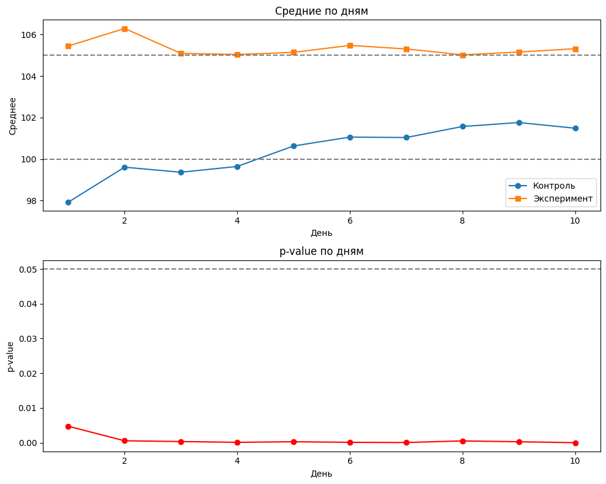
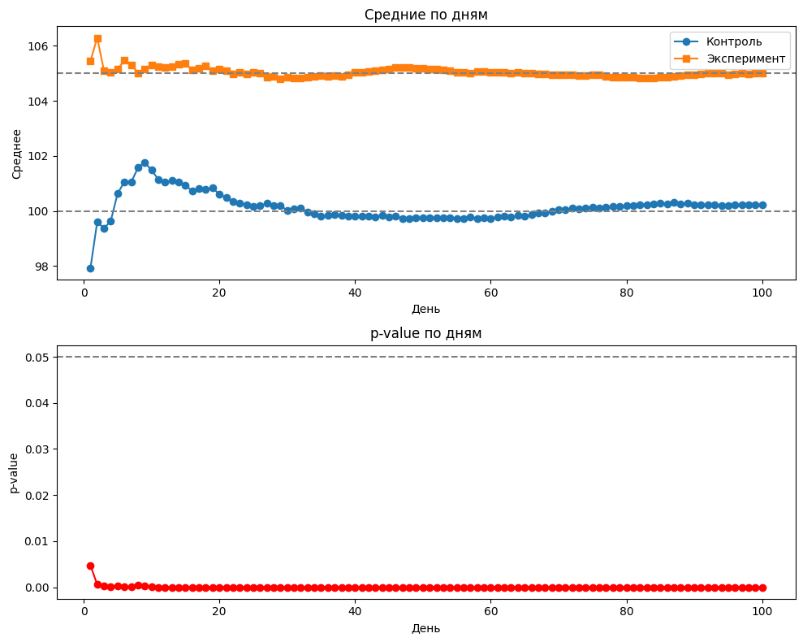
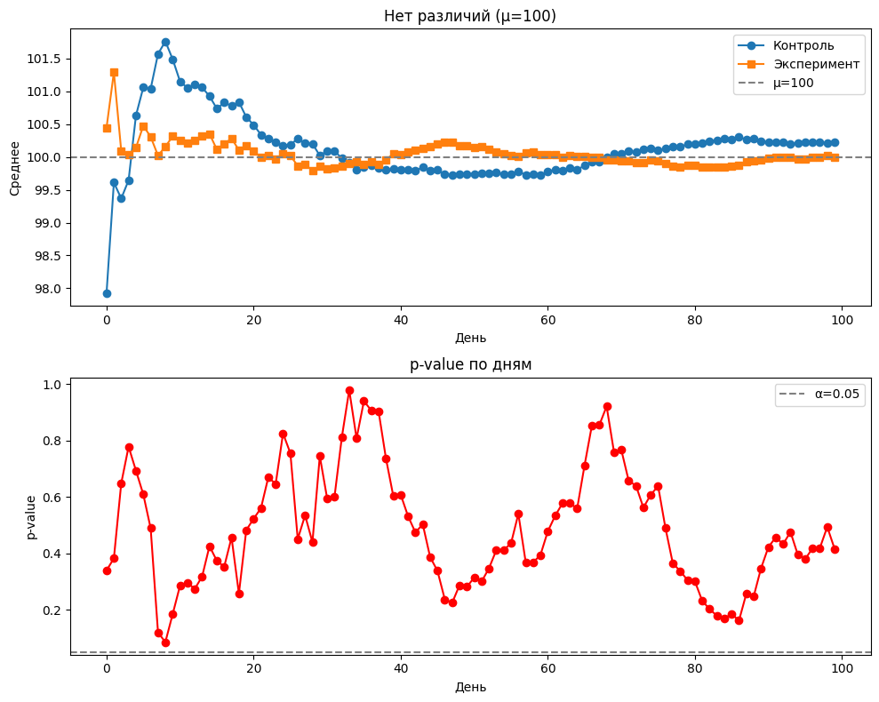

# A/B Тестирование: Проблема подглядывания (Peeking Problem)

## 1. Постановка задачи
В рамках лабораторной работы требовалось смоделировать процесс A/B-тестирования и исследовать, как ежедневный мониторинг p-value влияет на вероятность ошибки I рода (ложноположительного результата).

## 2. Методология
*   **Инструменты:** Python (NumPy, SciPy, Matplotlib).
*   **Генерация данных:** С помощью `np.random.normal` были созданы выборки для контрольной (μ=100, σ=20) и тестовой (μ=105, σ=20) групп.
*   **Моделирование:** На протяжении 10 и 100 дней имитировался приток по 100 новых пользователей в день. Накопленные данные ежедневно проверялись на статистическую значимость с помощью t-критерия Стьюдента (`scipy.stats.ttest_ind`).

## 3. Результаты эксперимента

### График 1: Динамика средних значений и p-value (10 дней)
На графике видно, как p-value стремительно падает и удерживается ниже уровня 0.05, начиная с первых дней эксперимента.

### График 2: Эксперимент на 100 дней
При увеличении длительности эксперимента p-value становится еще меньше — к 100 дню стремится к нулю (≈ 0.0000). Средние группы стабилизируются (контроль стремится к 100, эксперимент — к 105).

### График 3: Тест без реальных различий
Параметры генеральных совокупностей были изменены так, что различий между группами не было (μ=100 для обеих групп). В этом случае p-value колебалось выше уровня 0.05, что подтверждает корректность работы теста.

## 4. Главный вывод (Проблема подглядывания)
Если останавливать A/B-тест досрочно при первом же достижении p-value = 0.05, это **критически завышает вероятность ложноположительного результата**. Ошибка I рода возрастает с заявленных 5% до 20-30%. 

**Рекомендация для бизнеса:** Нельзя «подглядывать» за результатами теста и останавливать его раньше времени. Длительность эксперимента и размер выборки должны рассчитываться заранее, до запуска теста.

## 5. Ссылки
*   [Открыть Jupyter Notebook с полным кодом](https://colab.research.google.com/drive/123Jo-Ipv-DlQpPKndTCIRrrftmQ_LYHX?usp=sharing)
